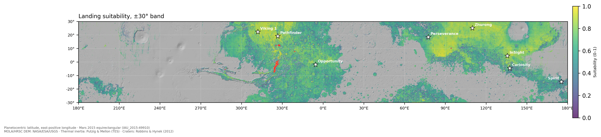
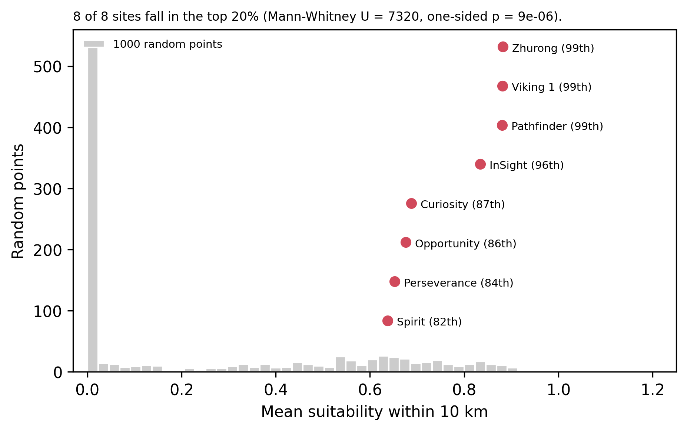

# Mars Landing Site Suitability (GIS + AHP)



Multi-criteria GIS analysis ranking equatorial Mars (±30°) for lander safety,
validated against 8 real landing sites.

**Research question:** can an Earth-style multi-criteria GIS model, built only from public
orbital data, reproduce the landing sites NASA and CNSA actually chose?

## Key result

<!-- RESULT -->
**8 of 8 real landing sites fall in the top 20 % of the ±30° band** (one-sided Mann–Whitney
p = 9 × 10⁻⁶, vs. 1,000 area-weighted random points).

Against the stricter reference (only ground that already passes the hard constraints),
**4 of 8 stay in the top 20 % (p = 0.0035)**, and they're exactly the safety-first sites:

| Site | Chosen for | Percentile (band) | Percentile (passing ground) |
|---|---|---|---|
| Zhurong (2021) | safety + science | 99.0 | 97.6 |
| Viking 1 (1976) | safety | 99.0 | 97.5 |
| Pathfinder (1997) | safety | 99.0 | 97.4 |
| InSight (2018) | safety | 96.0 | 90.4 |
| Curiosity (2012) | science | 87.0 | 63.3 |
| Opportunity (2004) | safety + science | 86.3 | 61.1 |
| Perseverance (2021) | science | 83.7 | 55.8 |
| Spirit (2004) | safety + science | 82.0 | 51.8 |

Science-driven sites that needed guided entry or Terrain-Relative Navigation (Gale, Jezero)
score in the middle of the safe ground. The model encodes engineering safety only, and the
gap measures what science bought at the cost of margin.

The top-10 zones lie mostly on the floors of the Ares/Tiu Vallis outflow channels
(≈ 325–328° E, −3–12° N), next to Pathfinder. A 200 m check of zone #1 (0.85° N, 326.92° E, 138 km²)
gives a median slope of 0.72° and 0 % of cells above 5°. ±20 % on any single AHP weight keeps
7–10 of the top-10 zones; the validation result barely moves under any weighting.


<!-- /RESULT -->

## Data

| Layer | Dataset | Resolution | Used for |
|---|---|---|---|
| Topography | MOLA–HRSC blended DEM v2 (Fergason et al. 2018) | 200 m | elevation, slope, roughness |
| Surface hardness | TES nightside thermal inertia (Putzig & Mellon 2007) | ~3 km (20 px/°) | dust vs. firm ground |
| Hazards | Robbins & Hynek (2012) crater database, D ≥ 1 km | 384,343 points | crater density |
| Science (optional) | Geologic map of Mars (Tanaka et al. 2014) | 1:20M | ancient terrain bonus |

Links, formats and citations: [data/SOURCES.md](data/SOURCES.md).
`scripts/download_data.py` fetches everything. The 11 GB DEM is read over HTTP, so
only the ±30° band is streamed (or ~240 MB from its overview with `--quick`).

## Method

1. **One grid.** All layers warped to Mars 2015 equirectangular (`IAU_2015:49910`,
   sphere R = 3,396,190 m), ±30°, 1 km pixels (21,338 × 3,556). Planetocentric latitude,
   east-positive longitude throughout.
2. **Six criteria.** Elevation, slope, roughness (TRI), thermal inertia, crater density
   (craters per 10⁴ km² within 50 km) and |latitude|. Slope, kernels and areas correct for
   the east–west pixel shrinking with cos(latitude) (−13 % at 30°).
3. **Normalization.** Linear fuzzy membership to 0–1. Roughness and crater density use
   min → 95th percentile, computed only on ground that passes the constraints.
4. **Hard constraints.** Excluded where elevation > +1 km, slope > 10°, or thermal inertia < 100 tiu.
5. **AHP weights.** Slope 0.274, roughness 0.274, elevation 0.154, thermal inertia 0.154,
   crater density 0.089, latitude 0.056. λmax = 6.041, CI = 0.008, **CR = 0.007** (< 0.10).
6. **Weighted overlay → candidate zones.** "Very high" quintile, 8-connected (merged across
   the 180° seam), ≥ 50 km² (about one landing ellipse), ranked by area-weighted mean score.
7. **Validation.** Mean score within 10 km of each site, compared with 1,000 random points
   drawn uniformly by area over all valid ground, using a one-sided Mann–Whitney U test.
8. **Sensitivity.** ±20/40 % one-at-a-time weight changes, three named scenarios, and 500
   Dirichlet Monte Carlo draws giving P(top 10 %) for each cell.

### Why these AHP judgements

| Pair | Judgement | Reasoning |
|---|---|---|
| Slope vs roughness | 1 | Both are direct tip-over / impact hazards at touchdown |
| Slope, roughness vs elevation, TI | 2 | Touchdown failure is immediate; elevation and TI degrade margins |
| Slope, roughness vs crater density | 3 | Craters matter mostly through the slopes and rocks they create, already counted |
| Slope, roughness vs latitude | 4 | Inside ±30° latitude is a power/thermal preference, not a hazard |
| Elevation vs TI | 1 | Both are hard engineering limits handled by the same mission phase (EDL / bearing) |
| Elevation, TI vs crater density | 2 | |
| Elevation, TI vs latitude | 3 | |
| Crater density vs latitude | 2 | |

## Outputs

- `outputs/suitability.tif` — final score (0–1; 0 = excluded)
- `outputs/top10_sites.gpkg` / `.csv` — top-10 zones with centroid, area and mean score
- `outputs/prob_top10pct.tif` — Monte Carlo P(top 10 %)
- `outputs/figures/` — hero map, criteria panel, validation, sensitivity, zoom-in, P(top 10 %) map
- `outputs/linkedin/` — 1.91:1 post image and a 5-slide PDF carousel

## Limitations

- 1 km resolution misses metre-scale rocks. TRI at 1 km mostly measures slope; a detrended
  200 m block standard deviation (`criteria.block_std`) is used for the zoom-in.
- Thresholds are illustrative, not mission specs. Real selection also uses rock abundance
  (HiRISE), radar reflectivity, wind and EDL dispersion ellipses.
- TES thermal inertia (~3 km) is upsampled bilinearly; it can't resolve dust patches inside a cell.
- Equirectangular is not equal-area. Zone areas use true cell areas, but polygon areas in
  the GeoPackage CRS are overstated by 1/cos(lat).

## Reproduce

```bash
conda env create -f environment.yml
conda activate mars-gis
python scripts/download_data.py --quick     # or without --quick for the full 200 m DEM
pytest                                      # 27 tests on synthetic data
jupyter lab                                 # run notebooks 01 → 04
python scripts/make_linkedin_images.py      # optional: post image + PDF carousel
```

If `pyproj` can't find `IAU_2015` codes, another PROJ install is shadowing yours (for
example PostGIS sets `PROJ_LIB`). Inside the conda env run `conda env config vars set PROJ_LIB=$CONDA_PREFIX/Library/share/proj`
(Windows) or unset `PROJ_LIB`.

## Repository layout

```
├── data/            SOURCES.md, landing_sites.csv (raw/ and processed/ are git-ignored)
├── notebooks/       01_preprocessing → 04_validation_sensitivity
├── scripts/         download_data.py, build_notebooks.py, make_linkedin_images.py
├── src/marsgis/     grid, data, criteria, ahp, overlay, validation, sensitivity, plots
├── tests/           test_pipeline.py
└── outputs/         figures/, linkedin/, top10_sites.gpkg
```

## Author

Mohamed Jihed Fradi — Geomatics Engineering student, MSE (Manouba)
